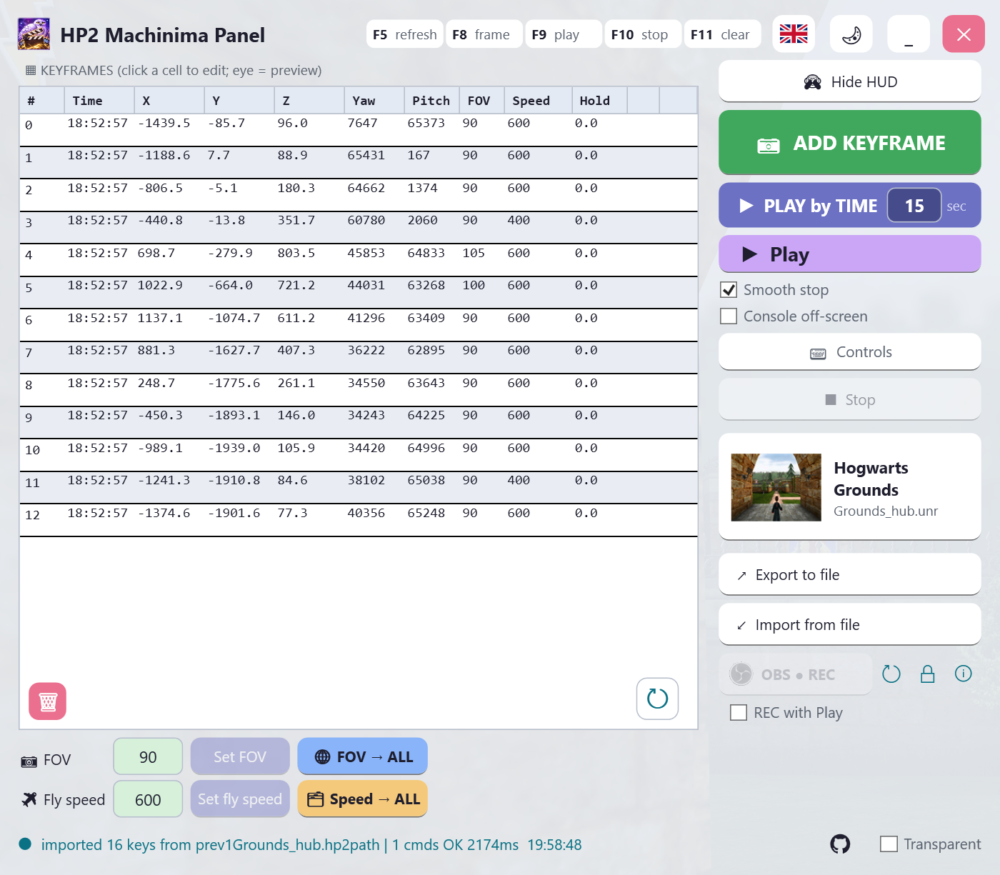

# HP2 Machinima Tool

A free-camera keyframe path tool for **Harry Potter and the Chamber of Secrets** (PC), built on top of [Metallicafan212's HP2 Engine / Extended Mod](https://discord.gg/2HG6Q7Ypau).

Fly your camera anywhere in the castle, drop keyframes along the way, then play the whole flight back as a smooth, engine-interpolated spline — perfect for recording machinima with OBS.

Inspired by the WoW Machinima Tool.

## ✅ Working now

- **Camera path system** (UnrealScript, compiled into `HGame.u`):
  - `PathAdd` — drop a keyframe (position + rotation) at the current free-camera pose
  - `PathPlay <seconds>` — the camera glides along a Catmull-Rom spline through all
    keyframes, interpolated **inside the engine every tick** (zero input jitter)
  - **Smooth stop** — cosine ease-in/out on the first and last segments
  - **Per-keyframe hold** — pause the camera on a frame for N seconds
  - `PathStop`, `PathClear`, `PathList`, `PathDumpKeys`
- **Free camera controls** (M212 engine): `Cam_Mode 9` detaches the camera;
  arrow keys fly it, WASD still moves Harry. `Cam_Mode 3` returns to the follow camera.
- **Exact-direction camera keys** `T`/`G` (world up/down) and `F`/`H` (turn in place,
  rate scales with fly speed) — remappable, see the panel's **⌨ Controls** modal.
- **Control panel** (`Panel/`) — an always-on-top WPF window:
  - **Keyframe table**: every keyframe with time, coords, angles, FOV, speed and
    hold — click any cell to edit, eye icon previews the pose, per-row delete.
  - **Playback**: `Play`, `PLAY by TIME <sec>`, `Stop`, **Smooth stop** toggle.
  - **Import / Export** keyframes as `.hp2path` files.
  - **Map picker** with previews, wrong-map lock and a "return to frames" button.
  - **OBS integration**: REC button (obs-websocket), optional *REC with Play*.
  - **Hide HUD**, EN/RU localization, dark/light themes, window transparency.
  - **Hotkeys**: `F5` refresh, `F8` frame, `F9` play, `F10` stop/abort, `F11` clear —
    they work while the game has focus.
  - **Keyframes survive restarts**: the panel autosaves them and restores on launch;
    the game keeps its path in the ini.
  - **Batch-file command channel**: the panel writes commands to a file and the
    engine executes them in one shot — imports of 100+ keyframes take seconds
    and don't degrade under game lag.

## Requirements

- Harry Potter and the Chamber of Secrets with **M212 Engine v3.4A+** (HP2 Extended)
- Windows 10/11 x64

## Install (patched HGame.u)

1. Back up `system/HGame.u`.
2. Copy the decomp folders (`HGame/`, `HPModels/`, `HPParticle/`, `HProps/`,
   `HPSounds/`) from [HP2UScriptDecompile](https://github.com/metallicafan212/HP2UScriptDecompile)
   (branch `Scaling-Patch`) next to the game's `system/` folder.
3. Apply the patch: run `Tools/apply-patch.ps1` against those folders
   (it inserts the path system into `BaseCam.uc` and the console execs into
   `HPConsole.uc`).
4. Run `system/compile-machinima.bat` **as administrator** — it deletes the stale
   `HGame.u` (important: UCC carries over old compiled classes otherwise) and
   rebuilds from sources.

Stock `*.u` backups go to `system/*.u.stock.bak` — rename to restore.

## Usage

1. Launch the game with `Start Game with Log.bat`, load a level.
2. Press `Cam_Mode 9` (console or hotkeys) for the free camera; `HideHud` hides the HUD.
3. Start `Panel/Start Panel.bat`.
4. Fly the camera (arrow keys + T/G/F/H), press `F8` to drop a keyframe at each pose.
5. Press `F9` (or **PLAY**) — the camera flies the spline; record with OBS.
6. Edit any value directly in the keyframe table; `F11` clears the path.

Full details: [Docs/USAGE.md](Docs/USAGE.md). Roadmap: [Docs/ROADMAP.md](Docs/ROADMAP.md).

## Console commands

| Command | Description |
|---|---|
| `PathAdd` | Add a keyframe at the current free-camera pose |
| `PathList` | Print all keyframes (position + rotation) |
| `PathClear` | Remove all keyframes |
| `PathPlay <seconds>` | Fly the path over `<seconds>` |
| `PathStop` | Stop a playing path |
| `HideHud` | Hide the HUD / lightning overlay |
| `PanelHideHud` | Same, callable from the console dispatch chain (used by the panel) |
| `PathDumpKeys` | Dump all keyframes as PATHEV events (the panel syncs from it) |
| `PathSmoothStop 0/1` | Toggle cosine ease-in/out at the path ends |
| `PathExportIni` / `PathImportIni` | Save / load the path to the ini (survives restarts) |
| `QuietConsole 0/1` | Panel terminal parked off-screen / visible |
| `CamBindUp/Down/Left/Right <vk>` | Remap the exact-direction keys (T/G/F/H) |
| `Cam_Mode 9` / `Cam_Mode 3` | Free camera / standard follow camera |
| `SloMo 0.5` | Slow the whole world down |
| `QuickSave` / `QuickLoad` | Reset the scene between takes |

## Known limitations

- Typed console commands can garble while the in-game terminal is open — keep it
  closed while sending commands from the panel (investigation: issue #22).
- Flying outside the level geometry renders washed-out zones — stay inside.

## Credits

- **Metallicafan212** — HP2 Engine/Editor, decompiled HGame sources
- **AdamJD & the HP2 modding community** — camera system (StateFreeCam, Cam_* commands)
- **BullDigga** — project author

## License

[MIT](LICENSE)
